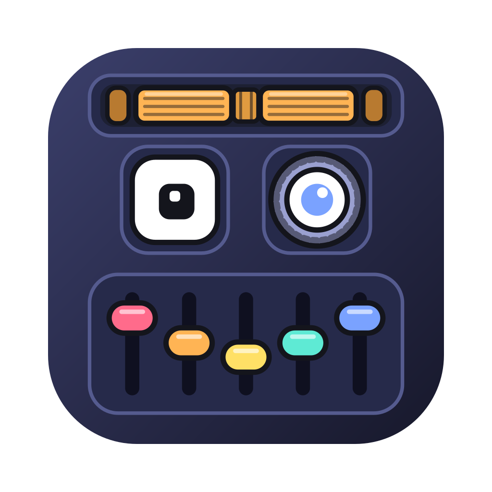
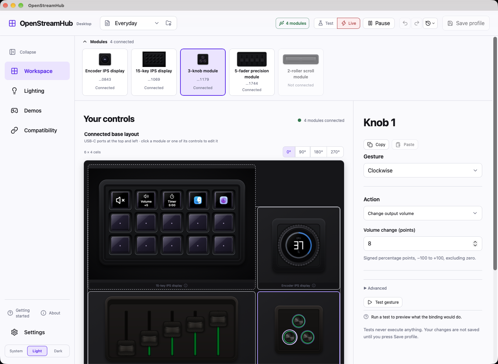
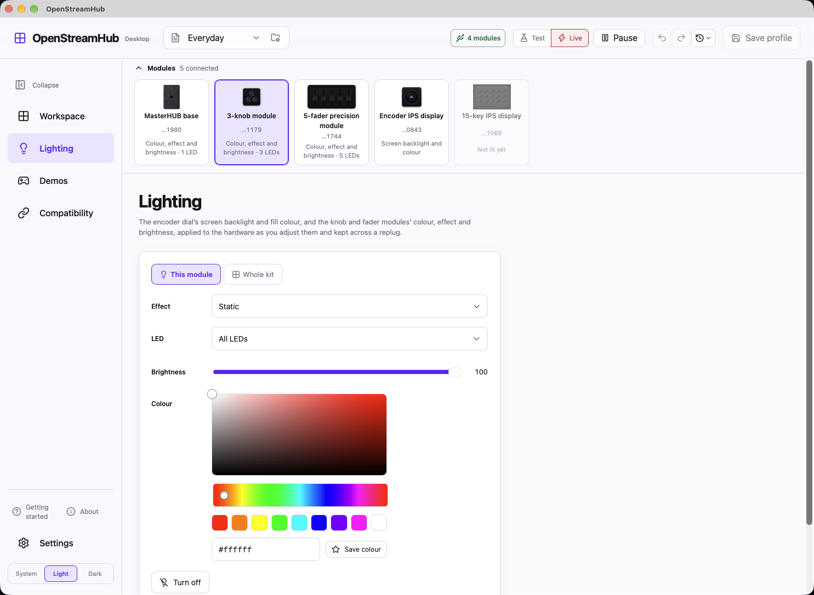
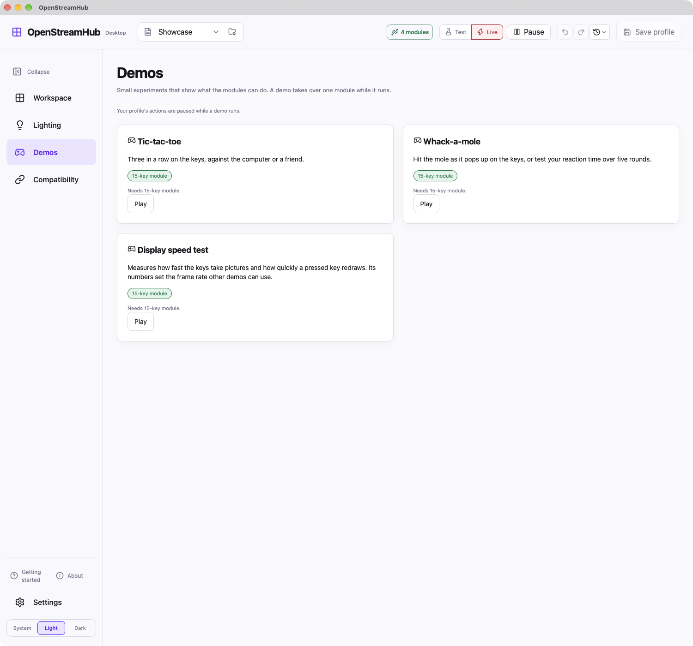
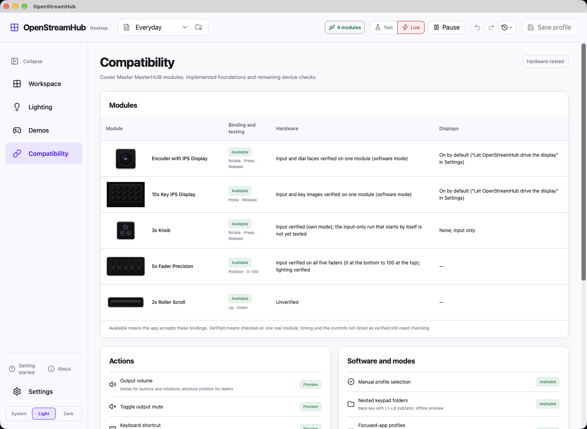
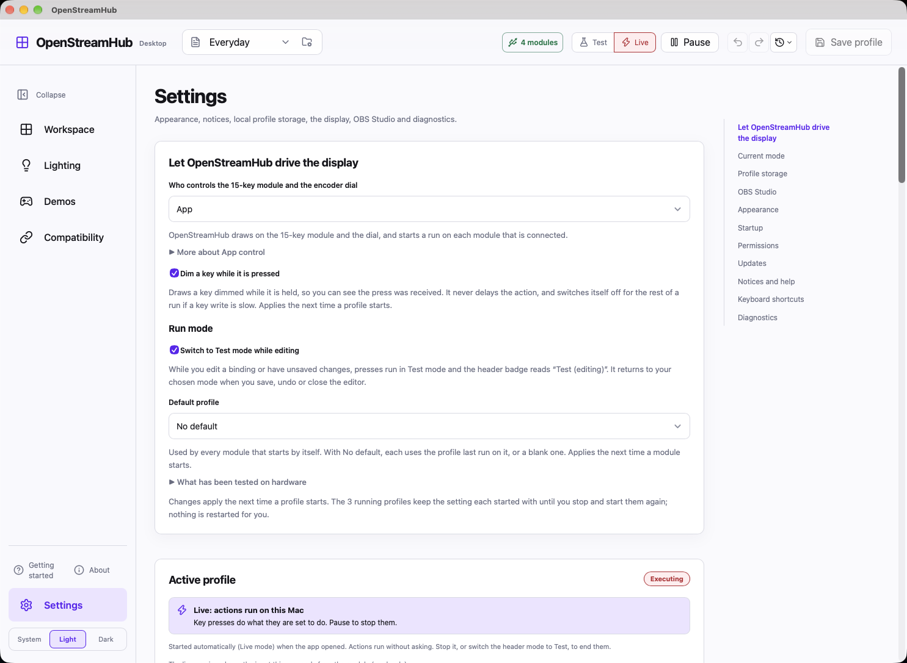

<div align="center">
  
  <h1>OpenStreamHub</h1>
  <p>Unofficial macOS support for Cooler Master MasterHUB.</p>
  <p>
    <a href="#screenshots">Screenshots</a> ·
    <a href="#install">Install</a> ·
    <a href="#quick-start">Quick start</a> ·
    <a href="#hardware-support">Hardware support</a> ·
    <a href="#documentation">Documentation</a> ·
    <a href="#development">Development</a>
  </p>
</div>

[](#license)
[](https://github.com/goniszewski/OpenStreamHub/releases/latest)


OpenStreamHub is a macOS desktop app, Rust SDK and set of diagnostic tools for **Cooler Master MasterHUB**. The goal is to provide the device controls, profiles, displays and actions available in the official Windows application, and extend them with more capabilities, supported apps and integrations.

Feature parity is incomplete. The comparison below uses the official **MasterHUB 1.0.0.113** software as its reference, based on analysis recorded in this repository. Implementation and physical hardware validation are tracked separately.

> [!NOTE]
> Supports **MasterHUB only**. This is an independent project, not affiliated with or endorsed by Cooler Master. Hardware results currently cover one rig; this is not yet a fully validated replacement for the Windows app.

## Screenshots

Tap or click any screenshot to open it at full size. They follow your light or dark theme.

<a href="docs/screenshots/light-1-workspace.png"><picture>
  <source media="(prefers-color-scheme: dark)" srcset="docs/screenshots/dark-1-workspace.png">
  
</picture></a>

<details>
<summary>More views: lighting, demos, compatibility and settings</summary>

**Lighting**

<a href="docs/screenshots/light-2-lighting.png"><picture>
  <source media="(prefers-color-scheme: dark)" srcset="docs/screenshots/dark-2-lighting.png">
  
</picture></a>

**Demos**

<a href="docs/screenshots/light-3-demos.png"><picture>
  <source media="(prefers-color-scheme: dark)" srcset="docs/screenshots/dark-3-demos.png">
  
</picture></a>

**Compatibility**

<a href="docs/screenshots/light-4-compatibility.png"><picture>
  <source media="(prefers-color-scheme: dark)" srcset="docs/screenshots/dark-4-compatibility.png">
  
</picture></a>

**Settings**

<a href="docs/screenshots/light-5-settings.png"><picture>
  <source media="(prefers-color-scheme: dark)" srcset="docs/screenshots/dark-5-settings.png">
  
</picture></a>

</details>

## Feature parity

| Feature in the official Windows app | OpenStreamHub on macOS |
| --- | --- |
| Keypad, knob and dial input | Implemented and tested on hardware. See [module support](#hardware-support) for limits. |
| Two-roller input | Decoder implemented. Windows input confirmed by capture; macOS receives no reports. Unresolved. |
| Five-fader input | Implemented and tested on hardware (all five faders, 0 at the bottom to 100 at the top). Jitter and the microphone-volume action are not yet checked. |
| Profiles, bindings and keypad folders | Implemented, including nested folders, Back navigation and profile switching. Folder redraws tested on hardware. |
| Key images and animations | Per-key static artwork and animation sequences implemented. Static artwork tested on hardware; animation playback still needs hardware acceptance. |
| Dial display and function switching | Image uploads, function labels, clocks and CPU display implemented and tested on hardware. Full display parity is incomplete. |
| Volume, mute, shortcuts, text, apps, URLs and media controls | Implemented; execution and macOS permission validation vary by action. See the [action catalogue](docs/masterhub-actions.md). |
| Multi-action and recorded key macros | Multi-action sequences and the key macro recorder implemented; the recorder still needs a hardware-session check. |
| Countdown timers | Implemented with notification and sound; remaining time is not displayed on the key. |
| OBS Studio actions | Partial implementation, tested against a fake server. Real OBS validation and remaining actions are pending. |
| Twitch, Discord, Streamlabs and application-specific integrations | Not implemented as equivalent integrations. Some shortcuts can be assigned manually. |
| Official `.mhz` profile import/export | Import implemented with a compatibility report and review before execution; real export compatibility remains to be validated. `.mhz` export missing. Own-format JSON import/export implemented. |
| Lighting and brightness | Lighting page for the base, knobs and faders, and screen backlight and colour for the dial, including while a profile runs. Per-profile screen brightness for the dial and the key screens (software dimming on keys) tested on hardware. Base, knob and fader lighting in the app still needs more hardware checks. |
| Firmware updates | Not supported. |
| Suspend/resume and reconnect | Session handling implemented; dial dry-run reconnect tested. Sleep/wake and other lifecycle paths still need hardware validation. |

OpenStreamHub also includes dry-run action previews, raw capture and offline replay, local diagnostic bundles, and optional focused-app profile rules. These are additional tools rather than Windows parity requirements.

See the [detailed parity tracker](docs/windows-parity-gaps.md) for protocol references and outstanding work. Some entries there describe earlier implementation stages; the [hardware results](docs/masterhub-hardware-results.md) record subsequent device tests.

## Install

Get the newest version from the **[latest release](https://github.com/goniszewski/OpenStreamHub/releases/latest)**; its page has the release notes and the downloads. Download the `.dmg` for your Mac (`aarch64` for Apple Silicon, `x86_64` for Intel; check the SHA-256 in `SHA256SUMS.txt`), open it and drag **OpenStreamHub** to **Applications**. It needs **macOS 12.3 or later**.

OpenStreamHub is **not signed or notarized**: signing needs a paid Apple Developer account, and this is a free, independent project. macOS therefore warns about it on first launch. The app is open source, so you can read the code or build it yourself ([Quick start](#quick-start)).

To open it anyway:

1. Open the app once. macOS says it cannot verify it and does not open it.
2. Open **System Settings → Privacy & Security**, scroll to the message about OpenStreamHub and choose **Open Anyway**, then confirm.

On macOS 14 and earlier, right-clicking the app and choosing **Open** also works. If you prefer the terminal, `xattr -dr com.apple.quarantine /Applications/OpenStreamHub.app` removes the download flag.

macOS asks for permission the first time an action needs it. Allow OpenStreamHub in **System Settings → Privacy & Security**. **Settings → Permissions** in the app shows what is granted and opens the right pane:

| Permission | Needed for |
| --- | --- |
| Accessibility | Keyboard shortcuts, text, undo/redo and media keys sent to other apps. |
| Automation | Controlling System Events and media players (Music, Spotify) from actions. |
| Input Monitoring | Reading the modules' input, and the key recorder. |

**Settings → Startup** can start the app at login and check these permissions each time it opens, with a short prompt that takes you to the right pane. Profiles are stored locally on your Mac. The app does not update itself: use **Settings → Updates** to see whether a newer release exists, then install it over the old one. Because the app is unsigned, macOS may ask you to allow these permissions again after an update.

## Quick start

Build from source on **macOS 12.3 or later**, with **Node.js 22.12+**, **Rust 1.97+** and the **Xcode command-line tools** installed.

```sh
git clone git@github.com:goniszewski/OpenStreamHub.git
cd OpenStreamHub/apps/open-stream-hub
npm ci
npm run desktop
```

The desktop command builds the Rust service sidecar before starting the app.

1. Connect your MasterHUB and select a module.
2. Create or edit a profile and assign its controls.
3. Start a **Dry run** to inspect input and planned actions.
4. Select **Execute** and confirm when you are ready to run those actions.

With **Settings → Let OpenStreamHub drive the display → App**, running a keypad or dial profile enables software mode and drives its display. Stopping the session restores the built-in animation. Choose **Built-in animation** to leave those modules in their own mode; their input requires software mode.

To build a local debug app bundle:

```sh
npm run desktop:build
```

See the [desktop guide](apps/open-stream-hub/README.md) for development details and the [build guide](docs/building-the-desktop-app.md) for bundling and signing. Signing and notarization remain release work.

## Hardware support

Support below describes the current macOS work. A decoder or editor alone does not establish hardware compatibility.

| Module | Current evidence |
| --- | --- |
| 15-key IPS keypad · M4315 | Press/release input, key artwork, nested folder redraws and Back navigation tested on hardware. Physical key mapping checked at selected positions. |
| 3-knob module · M003K | Rotation and press tested in default mode; physical mapping verified with the single knob on top. |
| IPS dial · M131E | Rotation, press, display faces, image upload, backlight and color tested. App dry-run reconnect tested. |
| 2-roller scroll module · M032LE | Windows capture confirms both rollers send input. macOS readers still receive no reports; investigation continues. |
| 5-fader module · M005S | Decoder and editor implemented; no physical module available for validation. |
| Base · M0064 | Discovered and recorded; observed reports are a constant heartbeat. |

These results come from one rig. Sleep/wake recovery, some lifecycle paths and real OBS behavior still need validation. See [hardware results](docs/masterhub-hardware-results.md) for the exact tests and limits, and the [parity tracker](docs/windows-parity-gaps.md) for gaps against the official Windows app.

## Privacy and telemetry

OpenStreamHub has no telemetry, analytics, automatic crash reporting, account or cloud sync. Profiles, settings, artwork and diagnostic bundles are stored locally. Diagnostic bundles are created on demand and are yours to share; sensitive fields are redacted by default.

The optional OBS integration connects only to OBS on the same Mac and is off until enabled. Its password stays in memory and must be entered again after launching the app. Configured actions can open apps or web addresses when executed.

The app does not contact a remote service on its own. **Settings → Updates** has a **Check for updates** button that asks GitHub for the latest release (an anonymous request that sends nothing but the app's name and version); an optional daily check on launch is off by default. The app never downloads or installs anything itself. Building from source downloads dependencies from npm and crates.io. See the [diagnostic bundle guide](docs/masterhub-diagnostic-bundle.md) for what local diagnostics contain.

## Documentation

| Start here | Reference |
| --- | --- |
| [Desktop app](apps/open-stream-hub/README.md) | [Action catalogue](docs/masterhub-actions.md) |
| [Profiles and binding service](docs/masterhub-service.md) | [Implementation status](docs/masterhub-implementation-status.md) |
| [Keypad folders](docs/masterhub-keypad-folders.md) | [Hardware results](docs/masterhub-hardware-results.md) |
| [Dial functions](docs/masterhub-dial-functions.md) | [Protocol evidence](docs/masterhub-protocol-evidence.md) |
| [Import official profiles](docs/importing-masterhub-profiles.md) | [Windows parity tracker](docs/windows-parity-gaps.md) |
| [Focused-app rules](docs/masterhub-focus-rules.md) | [macOS roadmap](docs/masterhub-macos-plan.md) |
| [Diagnostics and replay](docs/masterhub-diagnostics.md) | [Session lifecycle](docs/masterhub-session-manager.md) |
| [Display sync](docs/masterhub-display-sync.md) | [Release process](docs/release-process.md) |

Try the [example profiles](examples/profiles/), including [macOS controls](examples/profiles/macos.json), [all modules](examples/profiles/all-modules.json), [keypad folders](examples/profiles/keypad-folders.json) and [dial functions](examples/profiles/dial-functions.json).

## Development

The repository keeps the app, service and SDK together so protocol and profile changes can be developed together. The Rust crates retain their original `cooltek-sdk` names.

| Directory | Contents |
| --- | --- |
| `apps/open-stream-hub/` | Tauri desktop app and React interface |
| `crates/` | Rust SDK, binding service and command-line tools |
| `examples/` | Example programs and profiles |
| `docs/` | User guides, protocol research and validation records |

Build and check the Rust workspace from the repository root:

```sh
cargo build --workspace
cargo fmt --check
cargo test --workspace
cargo clippy --workspace --all-targets -- -D warnings
```

Check the desktop frontend:

```sh
cd apps/open-stream-hub
npm run check
npm test
npm run build
```

The app's Rust backend is a separate workspace; see the [desktop verification commands](apps/open-stream-hub/README.md#verify). Rebuild the sidecar with `npm run sidecar` after changing the SDK or service.

To use the SDK in another Rust project:

```toml
[dependencies]
cooltek-sdk = { git = "https://github.com/goniszewski/OpenStreamHub" }
```

Contributions are welcome. Keep changes focused, add relevant tests and documentation, and use Conventional Commits. For hardware changes, distinguish synthetic tests from observations on a real device.

## Acknowledgements

OpenStreamHub builds on [CoolTEK SDK by projectzero7](https://github.com/projectzero7/cooltek-sdk). Thanks to the original author and contributors for the foundation. This independently maintained project preserves that history and licensing while developing its own MasterHUB app and macOS support.

## Generative AI disclosure

Generative AI tools were used during reverse engineering, development and testing of this project. The maintainer reviews and tests every change. Hardware behaviour is claimed only where it was tested on a real device, as recorded in the [hardware results](docs/masterhub-hardware-results.md).

## License

Dual-licensed under [MIT](LICENSE-MIT) or [Apache-2.0](LICENSE-APACHE), at your option. Unless explicitly stated otherwise, contributions are provided under the same terms.
